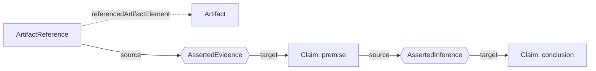

# SACM primer

SACM's concepts in a few lines each, for a reader who has not read the specification.
Clause numbers refer to [SACM 2.3][sacm] (OMG formal/23-05-08), which is the authority.

To use the crate, read the [user guide](GUIDE.md). This page explains what the crate models.

## An assurance case

An assurance case is "a collection of auditable claims, arguments, and evidence created to
support the contention that a defined system/service will satisfy its assurance requirements"
(clause 4).

SACM is a metamodel for exchanging such cases between tools.

- **A record, not a verdict.** Representing an argument in SACM "does not imply that the
  argument is complete, valid, or correct" (7.4). Evaluating it is outside SACM.
- **Claims and links.** A structured argument is argument elements, primarily claims,
  asserted by its author, with relationships asserted to hold between them (7.4).
- **Evidence.** Artifacts support the claims; SACM also records how they were made (7.5).

## Packages

A SACM model is organised in packages. Each of the four kinds can be the top object of a
file, a unit of interchange (clause 2).

| Package | Clause | Contains |
|---|---|---|
| `AssuranceCasePackage` | 9.2 | Sub-packages of all four kinds. The top-level container. |
| `ArgumentPackage` | 11.4 | A structured argument: claims and the relationships between them. |
| `ArtifactPackage` | 12.2 | The artifacts of the case and where they came from. |
| `TerminologyPackage` | 10.4 | Terms and expressions for naming and describing the other two. |

- **Nesting.** Each kind can contain packages of its own kind (9.2, 10.4, 11.4, 12.2).
- **One limit.** An `ArgumentPackage` with nested ArgumentPackages may contain only
  ArgumentPackages (11.4).
- **Groups.** `ArgumentGroup` (11.2), `ArtifactGroup` (12.3) and `TerminologyGroup` (10.3)
  refer to elements with a common purpose. They are not a packaging mechanism.

## What every element has

Almost every element is a `ModelElement` (8.6), which is a `SACMElement` (8.2).

| Feature | Clause | What it is |
|---|---|---|
| `name` | 8.6 | Required. A `LangString`: text with an optional language (8.3). |
| `description` | 8.9 | The content of the element, such as the text of a Claim. |
| `note` | 8.11 | An unstructured comment. |
| `taggedValue` | 8.12 | A key and a value: the extension mechanism. |
| `implementationConstraint` | 8.8 | See [abstract forms](#citations-and-abstract-forms). |
| `gid`, `isCitation`, `isAbstract` | 8.2 | See [citations and abstract forms](#citations-and-abstract-forms). |

The content of a description, note, constraint or tagged value is a `MultiLangString`: the
same text in several languages (8.5, 8.7).

## Claims and asserted relationships

A `Claim` records a proposition: a statement that is true or false (11.11). It is an
`Assertion` (11.10), and so is every relationship between claims.

An `AssertedRelationship` (11.13) links elements of the argument.

- **`source`.** One or more elements: where the relationship starts.
- **`target`.** Exactly one element: where it ends.
- **Direction.** An inference from Claim A (source) to Claim B (target) says that the truth
  of A infers the truth of B (11.13). The source is the premise, the target the conclusion.
- **`reasoning`.** Optional: an `ArgumentReasoning` (11.12) that describes the reasoning
  behind the relationship. Its `structure` can name an ArgumentPackage that holds the detail.
- **`isCounter`.** False by default. True makes the relationship counter its purpose: an
  `AssertedEvidence` with `isCounter` true is counter-evidence (11.13).

There are five kinds:

| Relationship | Clause | Asserts that | Ends |
|---|---|---|---|
| `AssertedInference` | 11.14 | One or more Assertions (premises) infer another (conclusion). | |
| `AssertedEvidence` | 11.15 | Cited artifacts help establish the truth of a Claim. | Each source must be an ArtifactReference. |
| `AssertedContext` | 11.16 | A cited artifact is the context of a Claim or an ArgumentReasoning; a Claim, of another Assertion or an ArgumentReasoning. | |
| `AssertedArtifactSupport` | 11.17 | One or more artifacts support another artifact. | Source and target must be ArtifactReferences. |
| `AssertedArtifactContext` | 11.18 | One or more artifacts provide context for another artifact. | Source and target must be ArtifactReferences. |

The ends of a relationship are elements of the argument (11.13). An argument therefore
reaches an artifact through an `ArtifactReference` (11.9), which cites artifacts through
`referencedArtifactElement`.

### The declaration of an assertion

Every Assertion has an `assertionDeclaration` that declares its state (11.8, 11.10).
Because a relationship is an Assertion, a relationship has one too.

| Literal | Meaning (11.8) |
|---|---|
| `asserted` | The default. The Assertion is asserted. |
| `needsSupport` | Further argumentation has yet to be provided to support it. |
| `assumed` | Declared as assumed to be true, rather than supported by further argumentation. |
| `axiomatic` | Axiomatically true; no further argumentation is needed. |
| `defeated` | Defeated by counter-evidence or argumentation. |
| `asCited` | The Assertion is cited: its declaration derives from that of the cited Assertion. |

- **`asserted` is not "proven".** A supporting argument is still expected; the structure may
  be incomplete (11.11).
- **`metaClaim`.** An Assertion can name Claims about itself, such as a Claim about the
  confidence in it (11.10).

## Evidence and artifacts

Artifacts are the main evidentiary elements of an assurance case (12.1). The rest of the
Artifact Metamodel records their provenance: how they were created and managed (7.5).

All of these are an `ArtifactAsset` (12.6), and each can hold `Property` elements.

| Class | Clause | What it records | Own features |
|---|---|---|---|
| `Artifact` | 12.7 | A unit of data used in the case: a plan, a report, a specification. | `version`, `date` |
| `Property` | 12.8 | A characteristic, such as a test result or a judgement of quality. | |
| `Event` | 12.9 | Something in the lifecycle of an Artifact: creation, modification. | `date` |
| `Resource` | 12.10 | Where an Artifact is found, usually a file. | `location` |
| `Activity` | 12.11 | A unit of work in the management of ArtifactAssets. | `startTime`, `endTime` |
| `Technique` | 12.12 | A method used to create, inspect, review or analyse an Artifact. | |
| `Participant` | 12.13 | A party involved: a person, an organization or a tool. | |
| `ArtifactAssetRelationship` | 12.14 | A link between assets. | `source`, `target` |

- **Relationships are open.** An `ArtifactAssetRelationship` has one or more sources and one
  or more targets. Its name and description say what it means (12.14); users choose the
  kinds (7.5).
- **Evidence is a role.** An Artifact becomes evidence when an ArtifactReference cites it
  and an `AssertedEvidence` links that reference to a Claim (11.15, 12.7).
- **More than artifacts can be cited.** Argument elements, terminology elements and
  AssuranceCasePackages are all an `ArtifactElement` (8.10, 9.2, 10.2, 11.3), which is what
  an ArtifactReference refers to.

## Terminology and expressions

A `TerminologyPackage` holds the vocabulary used to name and describe arguments and
artifacts (10.4). The formalism is there for those who need it, and is not mandated (10.1).

| Class | Clause | What it is |
|---|---|---|
| `Term` | 10.11 | One term. `externalReference` can name the object it refers to, such as a URI. |
| `Expression` | 10.10 | A phrase or sentence. `element` names the Terms and Expressions it is built from. |
| `Category` | 10.8 | A grouping of Terms, Expressions and Categories, such as the terms of one standard. |

- **`value`.** Required on a Term and on an Expression (10.9): the text.
- **Structured expressions.** An Expression's `value` can be a production rule that names
  its elements, for example as `$<ExpressionElement.name>$` (10.10).
- **Use in text.** An `ExpressionLangString` is a LangString that links to a Term or an
  Expression. When it does, its own `content` should be empty (8.4).

## Citations and abstract forms

These features belong to `SACMElement` (8.2), so every element has them.

- **`gid`.** An optional identifier, unique within the model instance. It is part of the
  model, unlike `xmi:id`, which XMI defines to identify an XML element within one file
  (XMI 2.5.1, 7.6.1).
- **Citation.** `isCitation` true marks an element that cites another element;
  `citedElement` names the one cited. If `citedElement` is set, `isCitation` must be true.
- **A cited Claim.** A Claim that cites another Claim, and is supported by it, can declare
  itself `asCited` (11.11).
- **Abstract.** `isAbstract` true marks an element as abstract, such as one that is part
  of a pattern or template.
- **Abstract form.** `abstractForm` on a concrete element names the abstract element it
  conforms to. The abstract one should be of the same type.

Patterns use two more things:

- **`ImplementationConstraint` (8.8).** A condition to fulfil before an abstract element
  becomes concrete. It should be given only on an abstract element (8.6).
- **Placeholders.** An abstract Term is a placeholder for a concrete one (10.11). An abstract
  Artifact is one agreed upon but not yet created, such as a planned hazard log (12.1).

## Modularity: package interfaces and bindings

Each of the four packages has an interface class and a binding class. Clause 4 defines the
terms, and Annex E (informative) illustrates them.

| | Package interface | Package binding |
|---|---|---|
| Purpose | Declares which elements of one package are public (clause 4). | Defines relationships among elements of its participant packages (clause 4). |
| Names | `implements`: the one package it declares (9.3, 10.5, 11.6, 12.5). | `participantPackage`: at least two packages it binds (clause 4, 9.4, 11.5, 12.4). |
| Contains | Citations of elements of that package (10.5, 11.6, 12.5). | Citations of the participants' elements, and what connects them (10.6, 11.5, 12.4). |

- **An interface is a package.** An `ArgumentPackageInterface` is a kind of ArgumentPackage,
  and resides inside the package it declares (11.6). A package may have several.
- **A participant** is a package or a package interface (clause 4). Naming an interface
  gives access through it; naming a package gives access to all its elements (9.4).
- **Assurance case level.** An `AssuranceCasePackageInterface` contains the interfaces of
  the sub-packages it makes public (9.3). The bindings of the other three kinds reside in an
  `AssuranceCasePackageBinding` (10.6, 11.5, 12.4).
- **Example.** One package has a Claim that `needsSupport`. A binding holds citations of that
  Claim and of a Claim in another package, and an argument that links the two (11.5).

## Where the standard disagrees with itself

The specification text and OMG's machine-readable model (ptc/22-03-13) differ in places.
This primer follows the text. Three differences a reader may meet:

- **`Resource.location`** is in the text (12.10) and absent from the model.
- **`ArtifactAssetRelationship`** (12.14) is named `ArtifactAssertedRelationship` in the model.
- **`description`** is at most one per element in the text (8.6) and any number in the model.

The [specification defects][defects] list has them all, with what the crate does about each.

## How the crate represents SACM

The model types mirror the metamodel: a `Document` holds elements, and each element has a
kind named after its SACM class and the features that class has. A reference is the id of
the element it names. XMI is the file format, as clause 2 requires.

| Concept | Where it lives |
|---|---|
| Every concrete class of the tables above | `sacm::model::ElementKind`, one variant per class |
| An element and its features | `sacm::model::SacmElement`, with accessors such as `name`, `sources`, `target` |
| `assertionDeclaration` | `sacm::model::AssertionDeclaration` |
| `isCitation`, `isAbstract`, `isCounter` | `sacm::model::Flag`, read with `SacmElement::flag` |
| `citedElement`, `abstractForm`, `source`, `target` and the other references | `sacm::model::ReferenceEnd` |
| `LangString`, `MultiLangString` | `sacm::model::LangString`, `sacm::model::MultiLangString` |
| Creating and changing elements | `sacm::edit`, with a create operation per class, such as `CreateClaim` |
| The rules of the clauses, reported as diagnostics | `sacm::validation::validate` |
| Reading and writing XMI | `sacm::xmi::read`, `sacm::xmi::write` |

The crate uses SACM's names only. A notation drawn over SACM is a concern of the tool that
draws it.

[sacm]: https://www.omg.org/spec/SACM/2.3
[defects]: https://github.com/lasrod/libSACM/blob/main/docs/sacm/reference/specification-defects.md
